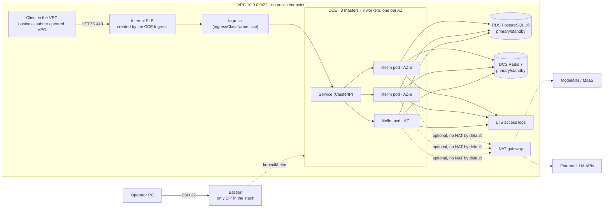

# LiteLLM Gateway on Huawei Cloud

Terraform + Helm deployment of [LiteLLM](https://github.com/BerriAI/litellm) as a
highly available OpenAI-compatible AI gateway on Huawei Cloud.


---

## What this is

LiteLLM gives you one OpenAI-compatible endpoint in front of 100+ model
providers, with virtual keys, budgets, spend tracking, fallbacks and an admin
UI. This repository deploys it the way a platform team would actually run it:

| Component | Implementation |
|---|---|
| Compute | CCE (Kubernetes) with 3 control-plane masters and one worker per AZ |
| Ingress | Dedicated ELB, **elastic L7 flavor** (LCU billing), EIP, TLS termination |
| State | RDS for PostgreSQL 16, primary/standby across two AZs |
| Cache / rate limits | DCS for Redis 7, primary/standby across two AZs |
| Egress | NAT gateway + SNAT for private access to model APIs |
| Secrets | CSMS (Cloud Secret Management) + generated passwords, never committed |
| Encryption | KMS key for RDS volumes and CCE node disks |
| Observability | LTS for ELB access logs, optional Cloud Eye alarms + SMN |
| Hybrid access | Optional VPN gateway (tunnel stays manual) |
| Private model access | Optional VPC endpoint for ModelArts / MaaS |

Everything is Terraform-native: `plan` shows the whole stack before anything is
created, and the same modules are reusable from other projects.

## Architecture



Pods run on the container tunnel network (`overlay_l2`, `172.16.0.0/16`), which
the VPC does not route: pod traffic reaches PostgreSQL/Redis with the node's
source address, so the data subnet only allows the app subnet. The ModelArts
VPC endpoint (optional) is the only other egress path.

Traffic path: client inside the VPC → internal ELB (TLS, created by the Ingress)
→ Service → one of three pods → model provider through NAT (or the ModelArts VPC
endpoint). Pods hold no state; the database and Redis carry everything that must
survive a pod or AZ failure.

## Quick start

### Step 0: toolchain (one minute)

```bash
./scripts/install-tools.sh --check   # what is missing
./scripts/install-tools.sh           # install it; on Windows, inside WSL2
```

### Production tier (CCE, HA) — the supported path

```bash
./scripts/creds.sh set          # AK/SK of a dedicated IAM user → $LITELLM_DEPLOY_HOME/secrets/hw.env (gitignored)

$EDITOR deploy-inputs.yaml      # the only other file you edit

./scripts/deploy.sh preflight   # validate + render into $LITELLM_DEPLOY_HOME/out/
./scripts/deploy.sh plan        # save a plan; changes nothing
#   ◄── read the plan before applying
./scripts/deploy.sh apply-infra # 20–40 min, mostly CCE
#   or: ./scripts/deploy.sh apply-stream  (same plan, live per-resource progress)
./scripts/deploy.sh --remote deploy-app   # helm, executed on the bastion
./scripts/deploy.sh --remote verify       # smoke test, executed on the bastion
./scripts/deploy.sh ingress              # converge the CCE ELB Ingress (idempotent)
./scripts/deploy.sh verify-ui            # HTML + screenshot proof through the bastion

./scripts/handoff.py scrub && ./scripts/handoff.py check   # after the test: no customer data left
```

`creds.sh` is the only place credentials are stored. `HW_ACCESS_KEY` /
`HW_SECRET_KEY` already exported still win, so CI needs no file. `handoff.py
form` prints the block to send a customer — it says where every value goes
without asking for a secret in a chat.

`--remote` exists because a machine outside the VPC cannot reach the cluster or
the gateway: the CCE API has no public endpoint and the ELB is private. The
bastion is the only host with a public IP, so in-cluster stages run there. It
needs only `kubectl` and `helm` — no Terraform, no AK/SK.

`ingress` is its own stage because the CCE ELB Ingress annotation
(`kubernetes.io/elb.autocreate`) is **immutable**: changing the subnet, zones,
port or flavor is rejected and the old ELB keeps serving. The stage compares the
cluster against the rendered bundle, deletes and recreates the Ingress when they
differ, then proves the VIP answers `/health/readiness`. `--check` reports the
drift without touching anything. `verify-ui` fetches `/ui/` through the bastion
and screenshots it with headless Chrome, so "it is deployed" is backed by an
artifact rather than a pod count.

Model endpoints and their keys are declared in `deploy-inputs.yaml`
(`models[]`); the keys themselves live in `$LITELLM_DEPLOY_HOME/secrets/app.env` (gitignored) and are
referenced by `api_key_env`. A simple example:

```bash
cat > $LITELLM_DEPLOY_HOME/secrets/app.env <<'EOF'
GLM_API_KEY=sk-...
DEEPSEEK_API_KEY=
EOF
```

Empty means "this endpoint does not authenticate". Never put a key in
`deploy-inputs.yaml`.

### Two things to change: the input list and a paste-ready prompt

**Runtime state lives outside the repository.** Nothing sensitive is written into
the checkout:

```
~/.litellm-deploy/           # default; override with LITELLM_DEPLOY_HOME
  secrets/hw.env             # AK/SK, written by creds.sh set (0600)
  secrets/app.env            # model provider keys
  out/                       # helm-values, preflight.json, apply-timeline.jsonl, evidence
  state/                     # bastion private key, saved plans, handoff backups
```

A `zip -r`, a stray `git add -f`, or handing the folder to someone else therefore
carries no credentials. The repository holds code and `.example` templates only.

**Required inputs** (everything else has a default; full list in `docs/inputs-guide.md`):

| Input | Where | Notes |
|---|---|---|
| `project_name` | `deploy-inputs.yaml` | prefix for every resource name, 3-24 lowercase |
| `region` | `deploy-inputs.yaml` | e.g. `cn-southwest-2` |
| `owner` | `deploy-inputs.yaml` | goes into resource tags |
| `bastion_ssh_cidrs` | `deploy-inputs.yaml` | public egress IPs allowed to SSH the bastion (the only place public ranges are accepted) - normally the machine running the deployment |
| `client_cidrs` / `admin_cidrs` | `deploy-inputs.yaml` | who may **call** the gateway / who may **reach the Admin UI**; see below |
| `models[]` | `deploy-inputs.yaml` | `name` / `model` / `mode`; omit `api_base` for the ModelArts VPCEP path |
| `HW_ACCESS_KEY` / `HW_SECRET_KEY` | `secrets/hw.env` | written interactively by `./scripts/creds.sh set` |
| model keys | `secrets/app.env` | variable names must match each model's `api_key_env` |

**What `client_cidrs` / `admin_cidrs` actually are.** They are *source* ranges
in the ELB security group's 443 ingress rule - who is allowed in, not networks to
create:

- `client_cidrs`: subnets allowed to call the inference API. Add your
  application's subnet when it exists.
- `admin_cidrs`: subnets allowed to reach the Admin UI and key-management API.
  Must be narrower, and must cover both the ops subnet (bastion, `10.0.3.0/24`)
  and the access subnet (ELB VIP, `10.0.0.0/24`); miss the access subnet and a
  `curl` from the bastion hangs instead of returning 403.
- Both must be VPC-internal (peering and VPN ranges are fine). A public CIDR is
  rejected by preflight.
- **You can leave them alone.** The default `10.0.3.0/24` means "bastion only",
  which is enough for a smoke test. Add the application subnet to
  `client_cidrs` later; there is no need to plan a new network before deploying.
- One trap: if the caller also runs inside this CCE cluster (`overlay_l2`), its
  traffic is SNATed to a node IP before leaving the VPC - add the app subnet
  (default `10.0.1.0/24`) to `client_cidrs`, or in-cluster callers are refused.

**Prompt to hand an agent** (edit the parameters, paste as-is):

```text
Deploy LiteLLM to Huawei Cloud from the repository huaweicloud-ha-litellm-deploy,
following the preflight -> plan -> human review -> apply-infra -> deploy-app ->
verify loop in AGENTS.md.

My parameters:
  project_name=acme-litellm
  region=cn-southwest-2
  owner=platform-team
  # who may SSH the bastion: the public egress IP of the machine running this
  bastion_ssh_cidrs=["<public egress IP of the agent's client>/32"]
  # who may call the gateway / reach the Admin UI: VPC-internal *sources*,
  # not networks to create; the default (ops subnet only) is enough to test
  client_cidrs=["10.0.3.0/24"]
  admin_cidrs=["10.0.3.0/24"]
  models: glm-5.3 -> openai/glm-5.3, api_base omitted (ModelArts VPCEP)

Rules:
1. Never ask me for AK/SK: I run ./scripts/creds.sh set myself (hidden input,
   writes ~/.litellm-deploy/secrets/hw.env), or export them in the same shell.
   Do not read, print or write those two values.
2. Run preflight first and ask all FAIL items at once; then stop after plan and
   show me the summary.
3. Only after I confirm, run apply-infra, reporting progress with apply-stream.
4. On any failure, stop and report the stage and the raw error. Do not bypass a
   check, and do not "fix" anything with a public EIP or a NAT gateway.
5. Finish with handoff.py scrub && check; it must print clean.
```


**Where it runs**

| Environment | Status | Notes |
|---|---|---|
| Linux / macOS | supported | bash + POSIX tools; this is what the scripts are developed on |
| Windows + WSL2 | recommended | clone inside WSL, install terraform / helm / kubectl / python3 / jq |
| Windows + Git Bash | untested | path translation and `chmod` differ from Linux; failures tend to appear mid-apply |
| Windows PowerShell | unsupported | the entry points are bash |

The deployment itself runs on Linux in the cloud (CCE nodes, the bastion); the
constraint is only on the machine you type commands on.

The toolchain is installed by the repo, not by hand:

```bash
./scripts/install-tools.sh --check    # report what is missing
./scripts/install-tools.sh            # terraform 1.17 / helm 3.16 / kubectl 1.37 / jq / curl / unzip / python3
DRY_RUN=1 ./scripts/install-tools.sh  # print the commands, change nothing
```

Better still, run the agent itself on a Linux VM in the cloud (Hermes on a small
ECS is the cheapest option): `apply-infra` runs for 20-40 minutes straight, and
laptop sleep, VPN flaps or a dropped ssh session turn into a failure that looks
like something else.

### Lab tier (single VM, ~10 minutes) — evaluation only

```bash
cp terraform/examples/vm-single/terraform.tfvars.example terraform/examples/vm-single/terraform.tfvars
$EDITOR terraform/examples/vm-single/terraform.tfvars  # set allowed_ingress_cidrs

terraform -chdir=terraform/examples/vm-single init
terraform -chdir=terraform/examples/vm-single apply
```

The instance installs Docker, starts PostgreSQL 16, Redis 7 and LiteLLM, and
serves `http://<eip>:4000`. Single point of failure, plain HTTP, secrets via
cloud-init — do not put production keys in it, and do not expect it to match the
HA tier's behaviour.


The master key is in CSMS and in `terraform output`:

```bash
terraform -chdir=terraform/examples/cce-ha output -json app_env | jq -r .LITELLM_MASTER_KEY
```

## What gets created

| Resource | Default | Notes |
|---|---|---|
| VPC + 6 subnets | `10.0.0.0/16` | app, data, VPCE and three ENI subnets |
| CCE cluster | `cce.s2.small`, 3 masters | one node pool per AZ |
| Worker nodes | 3 × `c7.xlarge.4` | 4 vCPU / 16 GiB each |
| RDS PostgreSQL | `rds.pg.n1.xlarge.2.ha`, 100 GB | primary/standby, 7-day backups |
| DCS Redis | `redis.ha.xu1.large.r2.2` | primary/standby, 2 GB |
| ELB | elastic L7, 2 AZs | 300 Mbit/s EIP, traffic billing |
| NAT | small, 100 Mbit/s EIP | SNAT for the VPC |
| KMS | 1 key, 90-day rotation | RDS volumes + node disks |
| CSMS | 4 secrets | master key, salt key, DB, Redis |
| LTS | 30-day retention | ELB access logs |
| Alarms | off by default | opt-in, see `enable_alarms` |

## Version baseline

Pinned: **LiteLLM `v1.106.3`** (released 2026-10-24), the newest stable release
at the time of writing. Two reasons this is a good baseline:

- it ships the rotated cosign signing key, so image verification matches the
  current upstream instructions;
- it contains the migration and spend-log indexing behaviour this repository
  automates (a separate migration job, `DISABLE_SCHEMA_UPDATE=true` on pods).

The tag lives in one place per example (`litellm_version`) and in
`charts/litellm/values.yaml`. Override it when your SWR mirror lags upstream.
Upgrade policy and rollback are in [docs/operations.md](docs/operations.md).

## Security model

- **No static credentials in the repository or in tfvars.** AK/SK live in
  `$LITELLM_DEPLOY_HOME/secrets/hw.env` (gitignored, `chmod 600`, written by `creds.sh`) or in the
  environment; `handoff.py check` fails while any of them are still present.
- **Every password is generated** by `random_password` per deployment: 24
  characters for database/Redis, 48 for the master and salt keys. Nothing is
  copied from another environment.
- **`LITELLM_SALT_KEY` has `prevent_destroy`.** It encrypts provider
  credentials at rest; replacing it makes them unreadable.
- **TLS is terminated at the ELB.** `enable_https = false` exists only for the
  lab tier and emits a warning.
- **Provider keys live in a Kubernetes Secret**, created from `$LITELLM_DEPLOY_HOME/secrets/app.env`
  (gitignored) or directly with `kubectl`. They never enter Helm values.
- **Data plane is VPC-only**: RDS and DCS accept 5432/6379 from the VPC CIDR
  only; neither gets a public IP.
- **State contains secrets.** Use the OBS backend example and restrict access.

See [docs/security.md](docs/security.md) for the full checklist.

## Repository layout

`docs/index.md` is the authoritative file map: what every script, module and
document is for, and which document answers which question. The short version:

| Path | Role |
|---|---|
| [`terraform/modules/`](terraform/modules) | 10 modules: `maas-network`, `bastion`, `cce`, `elb`, `postgres`, `redis`, `observability`, `vpcep`, `vpn`, `naming` |
| [`terraform/examples/cce-ha/`](terraform/examples/cce-ha) | Production: CCE + RDS + DCS + Ingress-owned ELB |
| [`terraform/examples/vm-single/`](terraform/examples/vm-single) | Lab: one ECS with local PostgreSQL and Redis |
| [`charts/litellm/`](charts/litellm) | Helm chart (migration hook, PDB, probes, topology spread; config rendered) |
| [`scripts/`](scripts) | Deployment engine: preflight/plan/apply, helm handoff, ingress convergence, image mirroring, destroy |
| [`docs/`](docs) | Architecture, deployment, operations, security, cost, troubleshooting, file map |
| [`monitoring/`](monitoring) | AOM alert rules + Grafana dashboard + wiring guide |
| [`skills/`](skills) | Agent skill with the deployment flow (installed via `make skill-install`) |

Full inventory: [docs/index.md](docs/index.md).

## Validation status

Two kinds of evidence, kept apart.

**Verified offline** (no cloud credentials; `make validate`):

- `terraform fmt -check` / `terraform validate` for all **10 modules and both
  examples**, Terraform 1.17.0, provider `huaweicloud/huaweicloud` **1.99.1**;
- `helm lint` / `helm template`, including the migration hook and the Ingress;
- `shellcheck` on every script, plus docs links, README parity and the file map
  in `docs/index.md`;
- monitoring assets: every alarm metric exists in both the rules and the dashboard.

**Verified against a live account** — one end-to-end run in `cn-southwest-2`,
then destroyed:

- staged apply (edge → data → compute → cache → ops) of the `cce-ha` example:
  CCE with 3 workers spread across AZs, RDS PostgreSQL HA, DCS Redis HA;
- schema migrations applied by the Helm pre-install hook — no manual SQL, no dump;
- 3 gateway replicas answered `/health/readiness` and `/v1/models` through the
  internal ELB that the CCE Ingress created;
- `/ui/` returned the SPA and rendered in a headless browser reached through the
  bastion;
- with the NAT gateway closed the pods still served traffic, so no pod egress is
  required once the image is mirrored into SWR;
- `terraform destroy` returned the account to zero resources for this project
  (`state list` empty, no EIP/ELB/RDS/DCS/CCE left).

**Not verified here**, and deliberately called out:

- regions other than `cn-southwest-2` (endpoint names, flavor codes, CCE minors);
- the TLS path — the test ran an HTTP listener, no SCM certificate;
- ModelArts / MaaS over VPCEP (the `vpcep` module); the test used
  OpenAI-compatible endpoints;
- AOM alarms firing (Cloud Eye metric names differ per region, so alarms ship
  opt-in);
- the `vm-single` lab example, and `--remote all` in a single invocation.

The first `terraform plan` in your account is still the real acceptance test.

## Documentation

| Document | Contents |
|---|---|
| [docs/index.md](docs/index.md) | **Start here**: which document answers which question, and what every file in the repository is for |
| [docs/architecture.md](docs/architecture.md) | Components, failure domains, request path, upgrade flow |
| [docs/architecture.html](docs/architecture.html) | Rendered topology: subnets, request path, ELB ownership, known pitfalls (regenerate with `scripts/draw-architecture-html.py`) |
| [docs/deployment.md](docs/deployment.md) | Prerequisites, IAM, credentials, step-by-step deploy |
| [docs/operations.md](docs/operations.md) | Scaling, upgrades, rollback, backup/restore, key rotation |
| [docs/security.md](docs/security.md) | Secrets, network, TLS, image verification, IAM, who calls the gateway |
| [docs/permissions.md](docs/permissions.md) | Required IAM roles per stage, minimal custom policy, CCE agency caveat |
| [docs/sa-checklist.md](docs/sa-checklist.md) | Tick-box planning checklist: network, egress, data, encryption, go-live |
| [docs/inputs-guide.md](docs/inputs-guide.md) | How to fill the inputs, how to write the model list |
| [docs/manual-deployment.md](docs/manual-deployment.md) | Console click-through when Terraform is not allowed |
| [docs/upgrade-procedure.md](docs/upgrade-procedure.md) | What a version bump actually requires |
| [monitoring/README.md](monitoring/README.md) | LTS logs, AOM metrics, alert rules, local Grafana |
| [skills/litellm-huaweicloud-deploy/SKILL.md](skills/litellm-huaweicloud-deploy/SKILL.md) | Agent skill: staged flow, bastion handoff, failure routing |
| [monitoring/alerting-rules.yaml](monitoring/alerting-rules.yaml) | AOM alert rules (availability, latency, errors, saturation) |
| [monitoring/grafana-dashboard.json](monitoring/grafana-dashboard.json) | Grafana dashboard for AOM's Prometheus endpoint |
| [docs/cost.md](docs/cost.md) | Resource list, reference prices, cost levers |
| [docs/troubleshooting.md](docs/troubleshooting.md) | Symptom → cause → fix |
| [docs/deployment-optimizations.md](docs/deployment-optimizations.md) | Field notes from real deployments: 22 issues, symptom -> cause -> fix |
| [docs/modelarts-intranet.md](docs/modelarts-intranet.md) | Calling ModelArts over a VPC endpoint |
| [docs/huaweicloud-regions.md](docs/huaweicloud-regions.md) | Regions, endpoints, AZ quirks, flavor codes |

## License

Apache-2.0. LiteLLM itself is MIT licensed and is not vendored here.
