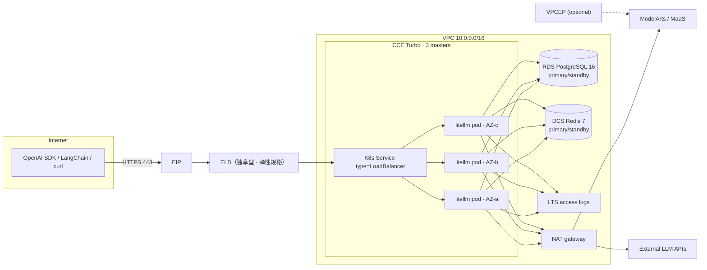

# LiteLLM Gateway on Huawei Cloud

Terraform + Helm deployment of [LiteLLM](https://github.com/BerriAI/litellm) as a
highly available OpenAI-compatible AI gateway on Huawei Cloud.


---

## What this is

LiteLLM gives you one OpenAI-compatible endpoint in front of 100+ model
providers, with virtual keys, budgets, spend tracking, fallbacks and an admin
UI. This repository deploys it the way a platform team would actually run it:

| Component | Implementation |
|---|---|
| Compute | CCE (Kubernetes) with 3 control-plane masters and one worker per AZ |
| Ingress | Dedicated ELB, **elastic L7 flavor** (LCU billing), EIP, TLS termination |
| State | RDS for PostgreSQL 16, primary/standby across two AZs |
| Cache / rate limits | DCS for Redis 7, primary/standby across two AZs |
| Egress | NAT gateway + SNAT for private access to model APIs |
| Secrets | CSMS (Cloud Secret Management) + generated passwords, never committed |
| Encryption | KMS key for RDS volumes and CCE node disks |
| Observability | LTS for ELB access logs, optional Cloud Eye alarms + SMN |
| Hybrid access | Optional VPN gateway (tunnel stays manual) |
| Private model access | Optional VPC endpoint for ModelArts / MaaS |

Everything is Terraform-native: `plan` shows the whole stack before anything is
created, and the same modules are reusable from other projects.

## Architecture



Traffic path: client → EIP → ELB (TLS) → Service → one of three pods → model
provider through NAT (or the ModelArts VPC endpoint). Pods hold no state; the
database and Redis carry everything that must survive a pod or AZ failure.

## Quick start

### Production tier (CCE, HA) — the supported path

```bash
./scripts/creds.sh set          # AK/SK of a dedicated IAM user → secrets/hw.env (gitignored)

$EDITOR deploy-inputs.yaml      # the only other file you edit

./scripts/deploy.sh preflight   # validate + render out/
./scripts/deploy.sh plan        # save a plan; changes nothing
#   ◄── read the plan before applying
./scripts/deploy.sh apply-infra # 20–40 min, mostly CCE
./scripts/deploy.sh --remote deploy-app   # helm, executed on the bastion
./scripts/deploy.sh --remote verify       # smoke test, executed on the bastion

./scripts/handoff.py scrub && ./scripts/handoff.py check   # after the test: no customer data left
```

`creds.sh` is the only place credentials are stored. `HW_ACCESS_KEY` /
`HW_SECRET_KEY` already exported still win, so CI needs no file. `handoff.py
form` prints the block to send a customer — it says where every value goes
without asking for a secret in a chat.

`--remote` exists because a machine outside the VPC cannot reach the cluster or
the gateway: the CCE API has no public endpoint and the ELB is private. The
bastion is the only host with a public IP, so in-cluster stages run there. It
needs only `kubectl` and `helm` — no Terraform, no AK/SK.

Model endpoints and their keys are declared in `deploy-inputs.yaml`
(`models[]`); the keys themselves live in `secrets/app.env` (gitignored) and are
referenced by `api_key_env`. A simple example:

```bash
cat > secrets/app.env <<'EOF'
GLM_API_KEY=sk-...
DEEPSEEK_API_KEY=
EOF
```

Empty means "this endpoint does not authenticate". Never put a key in
`deploy-inputs.yaml`.

### Lab tier (single VM, ~10 minutes) — evaluation only

```bash
cp terraform/examples/vm-single/terraform.tfvars.example terraform/examples/vm-single/terraform.tfvars
$EDITOR terraform/examples/vm-single/terraform.tfvars  # set allowed_ingress_cidrs

terraform -chdir=terraform/examples/vm-single init
terraform -chdir=terraform/examples/vm-single apply
```

The instance installs Docker, starts PostgreSQL 16, Redis 7 and LiteLLM, and
serves `http://<eip>:4000`. Single point of failure, plain HTTP, secrets via
cloud-init — do not put production keys in it, and do not expect it to match the
HA tier's behaviour.


The master key is in CSMS and in `terraform output`:

```bash
terraform -chdir=terraform/examples/cce-ha output -json app_env | jq -r .LITELLM_MASTER_KEY
```

## What gets created

| Resource | Default | Notes |
|---|---|---|
| VPC + 6 subnets | `10.0.0.0/16` | app, data, VPCE and three ENI subnets |
| CCE cluster | `cce.s2.small`, 3 masters | one node pool per AZ |
| Worker nodes | 3 × `c7.xlarge.4` | 4 vCPU / 16 GiB each |
| RDS PostgreSQL | `rds.pg.n1.xlarge.2.ha`, 100 GB | primary/standby, 7-day backups |
| DCS Redis | `redis.ha.xu1.large.r2.2` | primary/standby, 2 GB |
| ELB | elastic L7, 2 AZs | 300 Mbit/s EIP, traffic billing |
| NAT | small, 100 Mbit/s EIP | SNAT for the VPC |
| KMS | 1 key, 90-day rotation | RDS volumes + node disks |
| CSMS | 4 secrets | master key, salt key, DB, Redis |
| LTS | 30-day retention | ELB access logs |
| Alarms | off by default | opt-in, see `enable_alarms` |

## Version baseline

Pinned: **LiteLLM `v1.106.3`** (released 2026-10-24), the newest stable release
at the time of writing. Two reasons this is a good baseline:

- it ships the rotated cosign signing key, so image verification matches the
  current upstream instructions;
- it contains the migration and spend-log indexing behaviour this repository
  automates (a separate migration job, `DISABLE_SCHEMA_UPDATE=true` on pods).

The tag lives in one place per example (`litellm_version`) and in
`charts/litellm/values.yaml`. Override it when your SWR mirror lags upstream.
Upgrade policy and rollback are in [docs/operations.md](docs/operations.md).

## Security model

- **No static credentials in the repository or in tfvars.** AK/SK live in
  `secrets/hw.env` (gitignored, `chmod 600`, written by `creds.sh`) or in the
  environment; `handoff.py check` fails while any of them are still present.
- **Every password is generated** by `random_password` per deployment: 24
  characters for database/Redis, 48 for the master and salt keys. Nothing is
  copied from another environment.
- **`LITELLM_SALT_KEY` has `prevent_destroy`.** It encrypts provider
  credentials at rest; replacing it makes them unreadable.
- **TLS is terminated at the ELB.** `enable_https = false` exists only for the
  lab tier and emits a warning.
- **Provider keys live in a Kubernetes Secret**, created from `secrets/app.env`
  (gitignored) or directly with `kubectl`. They never enter Helm values.
- **Data plane is VPC-only**: RDS and DCS accept 5432/6379 from the VPC CIDR
  only; neither gets a public IP.
- **State contains secrets.** Use the OBS backend example and restrict access.

See [docs/security.md](docs/security.md) for the full checklist.

## Repository layout

```
terraform/
  modules/        network, postgres, redis, cce, elb, observability, vpn, vpcep
  examples/
    cce-ha/       production: CCE + ELB + RDS + DCS
    vm-single/    lab: one ECS with local PostgreSQL and Redis
charts/litellm/   Helm chart (migration hook, PDB, probes, topology spread; config rendered)
scripts/          deploy, migrate, smoke test, image mirroring, destroy
docs/             architecture, deployment, operations, security, cost, regions, checklist
monitoring/       AOM alert rules + Grafana dashboard + wiring guide
skills/           Agent skill with the deployment flow (installed via `make skill-install`)
```

## Validation status

Verified in this repository's build (no cloud credentials used):

- `terraform fmt -check` and `terraform validate` for all 8 modules and both
  examples, against provider `huaweicloud/huaweicloud` **1.99.1**;
- `helm lint` and `helm template` for the chart, including the migration hook;
- `shellcheck` on every script;
- the LiteLLM config boots against real PostgreSQL 16 and Redis 7 with image
  `v1.106.3`: migrations applied (213), spend-log indexes built,
  `/health/readiness` → `{"status":"healthy","db":"connected"}`,
  `/v1/models` returns the configured models.

Not verified here, and deliberately called out:

- a live `terraform apply` against a Huawei Cloud account (the build environment
  had no credentials and the project forbids testing in the intranet);
- region-specific flavor codes outside `cn-north-4`;
- the exact CCE Service annotation set on your CCE version — it is isolated in
  `scripts/deploy-app.sh` and easy to adjust;
- Cloud Eye metric names (alarms are opt-in for this reason).

The first `terraform plan` in your account is the real acceptance test.

## Documentation

| Document | Contents |
|---|---|
| [docs/architecture.md](docs/architecture.md) | Components, failure domains, request path, upgrade flow |
| [docs/deployment.md](docs/deployment.md) | Prerequisites, IAM, credentials, step-by-step deploy |
| [docs/operations.md](docs/operations.md) | Scaling, upgrades, rollback, backup/restore, key rotation |
| [docs/security.md](docs/security.md) | Secrets, network, TLS, image verification, IAM, who calls the gateway |
| [docs/sa-checklist.md](docs/sa-checklist.md) | Tick-box planning checklist: network, egress, data, encryption, go-live |
| [docs/inputs-guide.md](docs/inputs-guide.md) | How to fill the inputs, how to write the model list |
| [docs/manual-deployment.md](docs/manual-deployment.md) | Console click-through when Terraform is not allowed |
| [docs/upgrade-procedure.md](docs/upgrade-procedure.md) | What a version bump actually requires |
| [monitoring/README.md](monitoring/README.md) | LTS logs, AOM metrics, alert rules, local Grafana |
| [skills/litellm-huaweicloud-deploy/SKILL.md](skills/litellm-huaweicloud-deploy/SKILL.md) | Agent skill: staged flow, bastion handoff, failure routing |
| [monitoring/alerting-rules.yaml](monitoring/alerting-rules.yaml) | AOM alert rules (availability, latency, errors, saturation) |
| [monitoring/grafana-dashboard.json](monitoring/grafana-dashboard.json) | Grafana dashboard for AOM's Prometheus endpoint |
| [docs/cost.md](docs/cost.md) | Resource list, reference prices, cost levers |
| [docs/troubleshooting.md](docs/troubleshooting.md) | Symptom → cause → fix |
| [docs/modelarts-intranet.md](docs/modelarts-intranet.md) | Calling ModelArts over a VPC endpoint |
| [docs/huaweicloud-regions.md](docs/huaweicloud-regions.md) | Regions, endpoints, AZ quirks, flavor codes |

## License

Apache-2.0. LiteLLM itself is MIT licensed and is not vendored here.
