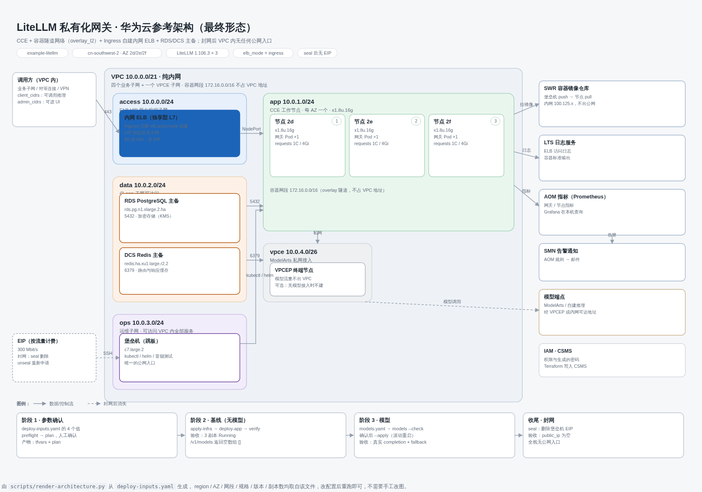
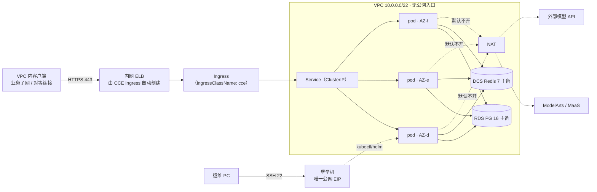

# 华为云 LiteLLM 高可用网关

用 Terraform + Helm 把 [LiteLLM](https://github.com/BerriAI/litellm) 部署成
华为云上的高可用、OpenAI 兼容 AI 网关。




<sub>全栈私有：ELB 是内网的，CCE 没有公网端点，堡垒机的 EIP 是唯一的公网地址——部署验证完成后
由 <code>deploy.sh seal</code> 删除。图中的规格、网段、版本都取自 <code>deploy-inputs.yaml</code>。</sub>

## 这是什么

LiteLLM 用一个 OpenAI 兼容端点统一 100+ 模型提供商，提供虚拟 Key、预算、
用量统计、故障转移和管理后台。本仓库按平台团队真正上线的方式部署它：

| 组件 | 实现 |
|---|---|
| 计算 | CCE（Kubernetes），3 个控制面 master + 每 AZ 一个工作节点池 |
| 入口 | 独享型 ELB，**弹性规格（按 LCU 计费）**，EIP，TLS 终结 |
| 状态 | RDS for PostgreSQL 16，跨 2 AZ 主备 |
| 缓存/限流 | DCS for Redis 7，跨 2 AZ 主备 |
| 出网 | NAT 网关 + SNAT，私有访问模型 API |
| 密钥 | CSMS + 每次部署随机生成，不入库 |
| 加密 | KMS 加密 RDS 卷与 CCE 节点盘 |
| 可观测 | LTS 采集 ELB 访问日志，可选 CES 告警 + SMN |
| 混合云 | 可选 VPN 网关（隧道手工对接） |
| 内网推理 | 可选 ModelArts VPCEP 私网接入 |

全部资源由 Terraform 管理：`plan` 可以先看全量变更，模块可被其他项目复用。

## 架构



Pod 运行在容器隧道网络（`overlay_l2`，`172.16.0.0/16`），VPC 不为该网段配路由：
Pod 访问 RDS/Redis 时源地址被转换为节点地址，所以data 子网只放行app 子网。

请求路径：VPC 内客户端 → 内网 ELB（TLS，由 Ingress 创建）→ Service → 三个 Pod 之一
→ 经 NAT 或 ModelArts VPCEP 调用模型。集群外唯一入口是堡垒机（公网 EIP），它只用于
helm/kubectl 和排障。Pod 无状态，需要跨故障保留的数据都在 RDS/Redis。

## 快速开始

> 下文所有命令都在**仓库根目录**执行（提示符是 `.../huaweicloud-ha-litellm-deploy$`）。已经 `cd scripts` 进去了就用 `./creds.sh`，而不是 `creds.sh`——`.` 不在 PATH 里。

### 三个阶段

| 阶段 | 你要给的 | 命令 | 完成判据 |
|---|---|---|---|
| **1 参数** | 运行 `./scripts/fill-inputs.sh` 回答 4 个问题（只改 `deploy-inputs.yaml` 这 4 行，逐项说明见 [`docs/phase1-inputs.md`](docs/phase1-inputs.md)） | `preflight` → `plan` | 0 blocking，plan 摘要经你确认 |
| **2 基线** | 无（模型不参与） | `apply-infra` → `deploy-app` → `verify` | readiness `db/redis connected`，`/v1/models` 返回 **200 + 空数组** |
| **3 模型** | `models.yaml`：模型 + fallback | `models --check` → `models --apply` | 模型列表正确、一次真实 completion、fallback 双向生效 |

每阶段可直接粘贴的提示词在 [`docs/prompts.md`](docs/prompts.md)。

三阶段都验收通过后做**收尾封网**：`CONFIRM=yes ./scripts/deploy.sh seal` 删除堡垒机 EIP，之后 VPC 内没有任何公网入口（这是这套设计的最终形态）。需要再运维时 `unseal` 重开，IP 会变。

模型单独成阶段的原因：它变更最频繁，而 `terraform apply` 不该为了加一个模型跑一遍。第 2
阶段部署的是「没有任何上游也能跑通」的网关，这样 `/v1/models` 返回空数组才是控制面的
真实信号，而不是被模型配置掩盖。

### 第 0 步：工具链（一分钟）

```bash
./scripts/install-tools.sh --check   # 缺什么
./scripts/install-tools.sh           # 装上；Windows 请在 WSL2 里跑
```

### 生产版（CCE 高可用）——受支持的路径

```bash
./scripts/creds.sh set          # 专用 IAM 用户的 AK/SK → $LITELLM_DEPLOY_HOME/secrets/hw.env（已 gitignore）
$EDITOR deploy-inputs.yaml      # 另一个需要改的文件

./scripts/deploy.sh preflight   # 校验参数并渲染 $LITELLM_DEPLOY_HOME/out/
./scripts/deploy.sh plan        # 生成 plan，不做任何变更
#   ◄── 人工看完 plan 再继续
./scripts/deploy.sh apply-infra # 20–40 分钟，主要是 CCE
#   或：./scripts/deploy.sh apply-stream（同一份 plan，逐资源实时进度）
./scripts/deploy.sh --remote deploy-app   # 在堡垒机上跑 helm
./scripts/deploy.sh --remote verify       # 在堡垒机上做 smoke
./scripts/deploy.sh ingress              # 一次性收敛 CCE ELB Ingress（幂等）
./scripts/deploy.sh verify-ui            # 通过堡垒机取 HTML + 截图取证

./scripts/handoff.py scrub && ./scripts/handoff.py check   # 测完清场，必须输出 clean
```

`creds.sh` 是凭据的唯一落盘位置；已经 export 的 `HW_ACCESS_KEY` / `HW_SECRET_KEY`
优先级更高，所以 CI 不需要文件。客户交付时把 `./scripts/handoff.py form` 的输出发过去，
上面写明了每个值填到哪，不会要求在聊天窗口里贴密钥。

`--remote` 的原因：VPC 外的机器既连不上集群（CCE 无公网端点），也访问不到
网关（ELB 是私网）。堡垒机是唯一有公网 IP 的主机，所以集群内动作都在那里执行，
它只需要 `kubectl` 和 `helm`，不需要 Terraform 和 AK/SK。

`ingress` 单独成一个阶段，是因为 `kubernetes.io/elb.autocreate` **不可修改**：
改子网、可用区、端口或规格都会被 API 拒绝，旧的 ELB 继续服务。该阶段把集群现状
和渲染出的 bundle 对比，不一致就删除重建，再通过 VIP 访问 `/health/readiness`
证明真的通了；加 `--check` 只报告漂移、不做变更。`verify-ui` 则通过堡垒机抓
`/ui/` 并用无头 Chrome 截图，让「已部署」有产物可查，而不是只看 Pod 数量。

模型端点和 KEY 分开管理：端点写在第 3 阶段的 `models.yaml`，KEY 写在
`$LITELLM_DEPLOY_HOME/secrets/app.env`（已 gitignore），YAML 里只用 `api_key_env` 引用变量名：

```bash
cat > $LITELLM_DEPLOY_HOME/secrets/app.env <<'EOF'
GLM_API_KEY=sk-...
DEEPSEEK_API_KEY=
EOF
```

留空表示该端点免认证。**不要把 KEY 写进 `deploy-inputs.yaml`。**

### 只改两处：变量清单 + 可直接粘贴的提示词

**运行时目录在仓库外。** 生成物和凭据都不落进仓库：

```
~/.litellm-deploy/           # 默认值，可用 LITELLM_DEPLOY_HOME 覆盖
  secrets/hw.env             # AK/SK（creds.sh set 写入，0600）
  secrets/app.env            # 模型 provider KEY
  out/                       # helm-values、preflight.json、apply-timeline.jsonl、验证产物
  state/                     # 堡垒机私钥、分阶段 plan、handoff 备份
```

这样 `zip -r`、误 `git add -f`、或把目录共享给别人，都不会把密钥带出去；仓库里只有代码和 `.example` 模板。

**必填清单**（其余变量都有默认值，全量见 `docs/inputs-guide.md`）：

| 变量 | 在哪 | 说明 |
|---|---|---|
| `project_name` | `deploy-inputs.yaml` | 所有资源名的前缀，3–24 位小写 |
| `region` | `deploy-inputs.yaml` | 例如 `cn-southwest-2` |
| `owner` | `deploy-inputs.yaml` | 负责人，写进资源标签 |
| `bastion_ssh_cidrs` | `deploy-inputs.yaml` | 允许 SSH 堡垒机的公网出口 IP（唯一接受公网段的地方），通常是执行部署的这台客户端的出口 IP |
| `client_cidrs` / `admin_cidrs` | `deploy-inputs.yaml` | 谁可以**调用**网关 / 谁可以**访问 Admin UI** 的源网段，见下方说明 |
| `HW_ACCESS_KEY` / `HW_SECRET_KEY` | `$LITELLM_DEPLOY_HOME/secrets/hw.env` | 由 `./scripts/creds.sh set` 交互写入；四种给法、报错对照、清理验证见 [`docs/credentials.md`](docs/credentials.md) |
| 模型 KEY | `secrets/app.env` | 变量名与模型条目的 `api_key_env` 对应 |

**`client_cidrs` / `admin_cidrs` 是什么，要不要动？**

这两个是「谁可以访问」的**来源**网段，写进 ELB 安全组的 443 入向规则；**不是让你新建网段**：

- `client_cidrs`：允许调用推理接口（`/v1/chat/completions`）的源网段。业务系统在哪个子网，就把它加进来。
- `admin_cidrs`：允许访问 Admin UI 与密钥管理 API 的源网段，应比 `client_cidrs` 窄。必须同时覆盖 ops 子网（堡垒机，`10.0.3.0/24`）和 access 子网（ELB VIP，`10.0.0.0/24`），漏掉 access 子网时堡垒机 `curl` 会一直挂住而不报 403。
- 两者都必须是 VPC 内私网地址（可以是对等连接、VPN 对端网段），公网段会被 preflight 直接拒绝。
- **可以不补**：默认值就是 `10.0.3.0/24`（运维子网），含义是「只有堡垒机能访问」，自测完全够用。等业务接入时再把业务子网 CIDR 加进 `client_cidrs`，不需要为了部署先去规划一个新网段。
- 一个容易踩的点：调用方如果也跑在这个 CCE 集群里（`overlay_l2` 容器网络），出 VPC 前会被 SNAT 成节点 IP，所以要把 app 子网（默认 `10.0.1.0/24`）加进 `client_cidrs`，否则集群内的应用调自己的网关会被拒。

**给 agent 的提示词**（改掉参数就能直接粘贴）：

```text
在仓库 huaweicloud-ha-litellm-deploy 中部署 LiteLLM 到华为云，按 AGENTS.md 的
preflight → plan → 人工确认 → apply-infra → deploy-app → verify 循环执行。

我的参数：
  project_name=acme-litellm
  region=cn-southwest-2
  owner=platform-team
  # 谁可以 SSH 堡垒机：执行本提示词的客户端（agent 所在机器）的公网出口 IP
  bastion_ssh_cidrs=["<执行本提示词的客户端公网出口IP>/32"]
  # 谁可以调用网关 / 访问 Admin UI：VPC 内私网段，是「来源」不是新建网段
  # 不填就沿用默认 10.0.3.0/24（只有运维子网，够自测）
  client_cidrs=["10.0.3.0/24"]
  admin_cidrs=["10.0.3.0/24"]
  （模型不在这个提示词里：第 2 阶段跑完再单独配，见下方第 3 阶段）

规则：
1. 不要向我索要 AK/SK：我会自己执行 ./scripts/creds.sh set（隐藏输入，
   写入 ~/.litellm-deploy/secrets/hw.env），或在同一个 shell 里 export。
   你不要读取、打印或写入这两个值。
2. 先跑 preflight，把 FAIL 项一次问完；然后只跑到 plan，把摘要给我确认。
3. 我说「确认」之后再 apply-infra，过程中用 apply-stream 汇报进度。
4. 任何阶段失败就停下，报阶段名和原始错误；不要绕过检查，也不要用公网 EIP/NAT 绕问题。
5. 收尾跑 handoff.py scrub && check，必须输出 clean。
```


**运行环境**

| 环境 | 状态 | 说明 |
|---|---|---|
| Linux / macOS | ✅ 支持 | 脚本是 bash + POSIX 工具，这是原始开发环境 |
| Windows + WSL2 | ✅ 推荐 | 在 WSL 里 clone，并装 terraform / helm / kubectl / python3 / jq |
| Windows + Git Bash | ⚠️ 未验证 | 路径转换和 `chmod` 与 Linux 不一致，可能在中途才失败 |
| Windows PowerShell | ❌ 不支持 | 入口脚本是 bash |

部署本身跑在云上的 Linux（CCE 节点、堡垒机），和客户端装什么系统无关；限制只在你敲命令的这一侧。

缺工具不用手工找：

```bash
./scripts/install-tools.sh --check    # 只检查，缺什么列什么
./scripts/install-tools.sh            # 装 terraform 1.17 / helm 3.16 / kubectl 1.37 / jq / curl / unzip / python3
DRY_RUN=1 ./scripts/install-tools.sh  # 只打印命令，不动系统
```

更省事的做法是把 agent 本身跑在一台云上 Linux 虚机里（Hermes on ECS 最便宜）：`apply-infra` 要连续跑 20–40 分钟，笔记本休眠、VPN 抖动、跨时区 SSH 断线都会变成“中途失败但看不出原因”。

### 单机版（vm-single，约 10 分钟）——仅评估

```bash
cp terraform/examples/vm-single/terraform.tfvars.example terraform/examples/vm-single/terraform.tfvars
$EDITOR terraform/examples/vm-single/terraform.tfvars   # 改 allowed_ingress_cidrs

terraform -chdir=terraform/examples/vm-single init
terraform -chdir=terraform/examples/vm-single apply
```

实例会自动装 Docker，启动 PostgreSQL 16、Redis 7 和 LiteLLM，访问
`http://<eip>:4000`。单点、明文 HTTP、密钥经 cloud-init 下发，
**不要放生产 Key**，也不要指望它和生产版行为一致。

主密钥在 CSMS 和 Terraform 输出里：

```bash
terraform -chdir=terraform/examples/cce-ha output -json app_env | jq -r .LITELLM_MASTER_KEY
```

## 版本基线

固定 **LiteLLM `v1.106.3`**（2026-10-24 发布，写作时最新稳定版）：

- 包含 1.106.3 起更换的 cosign 签名密钥，镜像验签与上游一致；
- 包含本仓库自动化的迁移 + SpendLogs 索引行为（独立迁移 Job，
  Pod 侧 `DISABLE_SCHEMA_UPDATE=true`）。

版本号只在 `litellm_version` 和 chart `values.yaml` 两处。升级与回滚流程见
[docs/operations.md](docs/operations.md)。

## 安全模型

- **仓库和 tfvars 里没有静态凭据**：AK/SK 放在 `$LITELLM_DEPLOY_HOME/secrets/hw.env`（已 gitignore、
  `chmod 600`，由 `creds.sh` 写入）或环境变量里；`handoff.py check` 只要还留着就报错。
- **所有密码每次部署随机生成**：数据库/Redis 24 位，主密钥/盐密钥 48 位。
- **`LITELLM_SALT_KEY` 带 `prevent_destroy`**：它加密数据库里的 provider
  凭据，换了就解不开。
- **TLS 在 ELB 终结**，`enable_https = false` 只用于实验环境。
- **Provider Key 只进 Kubernetes Secret**，不进 Helm values。
- **数据面仅 VPC 可达**：RDS/DCS 不绑公网 IP，安全组只放行 VPC 网段。

完整清单见 [docs/security.md](docs/security.md)。

## 目录结构

`docs/index.md` 是权威的文件地图：每个脚本、模块、文档负责什么，什么问题该看哪一篇。概览：

| 路径 | 作用 |
|---|---|
| [`terraform/modules/`](terraform/modules) | 10 个模块：`maas-network`、`bastion`、`cce`、`elb`、`postgres`、`redis`、`observability`、`vpcep`、`vpn`、`naming` |
| [`terraform/examples/cce-ha/`](terraform/examples/cce-ha) | 生产：CCE + RDS + DCS + 由 Ingress 自建的 ELB |
| [`terraform/examples/vm-single/`](terraform/examples/vm-single) | 单机实验：一台 ECS + 本地 PostgreSQL / Redis |
| [`charts/litellm/`](charts/litellm) | Helm chart（迁移 hook、PDB、探针、拓扑打散；config 由 values + 参数渲染） |
| [`scripts/`](scripts) | 部署引擎：preflight/plan/apply、helm 交接、Ingress 收敛、镜像同步、销毁 |
| [`docs/`](docs) | 架构、部署、运维、安全、成本、排障、文件地图 |
| [`monitoring/`](monitoring) | AOM 告警规则 + Grafana 看板 + 接入说明 |
| [`skills/`](skills) | agent skill（部署流程），`make skill-install` 安装 |

完整清单见 [docs/index.md](docs/index.md)。

## 验证状态

两类证据分开列。

**离线验证**（不需要云凭据，`make validate`）：

- **10 个模块 + 2 个示例**的 `terraform fmt -check` / `terraform validate`，
  Terraform 1.17.0，provider `huaweicloud/huaweicloud` **1.99.1**；
- chart 的 `helm lint` / `helm template`，含迁移 hook 与 Ingress；
- 所有脚本通过 `shellcheck`；文档链接、中英 README 链接一致性、
  `docs/index.md` 文件地图完整性；
- 监控资产：告警规则里的每个指标都能在看板中找到。

**真实账号验证**——在 `cn-southwest-2` 完整跑通一次，随后销毁：

- `cce-ha` 示例按 edge → data → compute → cache → ops 分阶段 apply：CCE 3 节点
  跨 AZ、RDS PostgreSQL 主备、DCS Redis 主备；
- 表结构由 Helm pre-install hook 自动迁移，未手工执行 SQL、未导入 dump；
- 3 个网关副本通过 CCE Ingress 自建的内网 ELB 正常响应
  `/health/readiness` 与 `/v1/models`；
- `/ui/` 返回 SPA，并经堡垒机用无头浏览器渲染成功；
- 关闭 NAT 网关后 Pod 仍正常服务（镜像已入 SWR 时不需要 Pod 出公网）；
- `terraform destroy` 后本工程在账号内资源归零（`state list` 为空，
  EIP/ELB/RDS/DCS/CCE 均无残留）。

**未验证**，明确标注：

- `cn-southwest-2` 以外的区域（endpoint、规格编码、CCE 版本）；
- TLS 路径——测试使用的是 HTTP 监听，未接 SCM 证书；
- 经 VPCEP 访问 ModelArts / MaaS（`vpcep` 模块）——测试用的是 OpenAI 兼容端点；
- AOM 告警实际触发（Cloud Eye 指标名因区域而异，告警默认不启用）；
- `vm-single` 单机示例，以及 `--remote all` 一次跑完的路径。

你账号里的第一次 `terraform plan` 仍然是真正的验收。

## 文档

| 文档 | 内容 |
|---|---|
| [docs/index.md](docs/index.md) | **先看这篇**：哪个问题看哪篇文档，以及仓库里每个文件的职责 |
| [docs/architecture.md](docs/architecture.md) | 组件、故障域、请求链路、升级流程 |
| [docs/architecture.html](docs/architecture.html) | 可视化架构：子网、请求链路、ELB 归属、坑位索引（静态产物） |
| [docs/deployment.md](docs/deployment.md) | 前置条件、IAM、凭据、逐步部署 |
| [docs/operations.md](docs/operations.md) | 扩缩容、升级、回滚、备份恢复、密钥轮换 |
| [docs/security.md](docs/security.md) | 密钥、网络、TLS、镜像验签、IAM、谁可以调用 |
| [docs/sa-checklist.md](docs/sa-checklist.md) | 可勾选的规划清单：网络、外网边界、数据、加密、上线 |
| [docs/permissions.md](docs/permissions.md) | IAM 最小权限清单、CCE 委托、策略命名（`*FullPolicy`） |
| [docs/inputs-guide.md](docs/inputs-guide.md) | 参数怎么填，模型列表怎么写 |
| [docs/manual-deployment.md](docs/manual-deployment.md) | 不用 Terraform 时的手工控制台步骤 |
| [docs/upgrade-procedure.md](docs/upgrade-procedure.md) | 版本升级必须走的流程 |
| [monitoring/README.md](monitoring/README.md) | LTS 日志、AOM 指标、告警导入、本机 Grafana |
| [monitoring/alerting-rules.yaml](monitoring/alerting-rules.yaml) | AOM 告警规则（可用性/延迟/错误/饱和） |
| [monitoring/grafana-dashboard.json](monitoring/grafana-dashboard.json) | Grafana 看板（对接 AOM 的 Prometheus 端点） |
| [skills/litellm-huaweicloud-deploy/SKILL.md](skills/litellm-huaweicloud-deploy/SKILL.md) | agent skill：阶段流程、堡垒机交接、故障路由 |
| [docs/cost.md](docs/cost.md) | 资源清单、参考价格、降本手段 |
| [docs/troubleshooting.md](docs/troubleshooting.md) | 现象 → 原因 → 处理 |
| [docs/deployment-optimizations.md](docs/deployment-optimizations.md) | 真实部署的 22 个坑位：现象、根因、修法 |
| [docs/modelarts-intranet.md](docs/modelarts-intranet.md) | 通过 VPCEP 私网调用 ModelArts |
| [docs/huaweicloud-regions.md](docs/huaweicloud-regions.md) | Region、Endpoint、AZ 规律、规格编码 |

## 许可证

Apache-2.0。LiteLLM 本身是 MIT 许可，本仓库不内联其代码。
