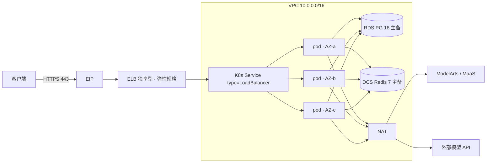

# 华为云 LiteLLM 高可用网关

用 Terraform + Helm 把 [LiteLLM](https://github.com/BerriAI/litellm) 部署成
华为云上的高可用、OpenAI 兼容 AI 网关。


## 这是什么

LiteLLM 用一个 OpenAI 兼容端点统一 100+ 模型提供商，提供虚拟 Key、预算、
用量统计、故障转移和管理后台。本仓库按平台团队真正上线的方式部署它：

| 组件 | 实现 |
|---|---|
| 计算 | CCE（Kubernetes），3 个控制面 master + 每 AZ 一个工作节点池 |
| 入口 | 独享型 ELB，**弹性规格（按 LCU 计费）**，EIP，TLS 终结 |
| 状态 | RDS for PostgreSQL 16，跨 2 AZ 主备 |
| 缓存/限流 | DCS for Redis 7，跨 2 AZ 主备 |
| 出网 | NAT 网关 + SNAT，私有访问模型 API |
| 密钥 | CSMS + 每次部署随机生成，不入库 |
| 加密 | KMS 加密 RDS 卷与 CCE 节点盘 |
| 可观测 | LTS 采集 ELB 访问日志，可选 CES 告警 + SMN |
| 混合云 | 可选 VPN 网关（隧道手工对接） |
| 内网推理 | 可选 ModelArts VPCEP 私网接入 |

全部资源由 Terraform 管理：`plan` 可以先看全量变更，模块可被其他项目复用。

## 架构



请求路径：客户端（业务子网）→ 内网 ELB → Service → 三个 Pod 之一 → 经 NAT 或
ModelArts VPCEP 调用模型。集群外唯一入口是堡垒机（公网 EIP），它只用于
helm/kubectl 和排障。Pod 无状态，需要跨故障保留的数据都在 RDS/Redis。

## 快速开始

### 生产版（CCE 高可用）——受支持的路径

```bash
export HW_ACCESS_KEY=... HW_SECRET_KEY=...   # 专用 IAM 用户，不要用主账号
$EDITOR deploy-inputs.yaml                   # 唯一需要改的文件

./scripts/deploy.sh preflight   # 校验参数并渲染 out/
./scripts/deploy.sh plan        # 生成 plan，不做任何变更
#   ◄── 人工看完 plan 再继续
./scripts/deploy.sh apply-infra # 20–40 分钟，主要是 CCE
./scripts/deploy.sh --remote deploy-app   # 在堡垒机上跑 helm
./scripts/deploy.sh --remote verify       # 在堡垒机上做 smoke
```

`--remote` 的原因：VPC 外的机器既连不上集群（CCE 无公网端点），也访问不到
网关（ELB 是私网）。堡垒机是唯一有公网 IP 的主机，所以集群内动作都在那里执行，
它只需要 `kubectl` 和 `helm`，不需要 Terraform 和 AK/SK。

模型端点和 KEY 分开管理：端点写在 `deploy-inputs.yaml` 的 `models[]`，KEY 写在
`secrets/app.env`（已 gitignore），YAML 里只用 `api_key_env` 引用变量名：

```bash
cat > secrets/app.env <<'EOF'
GLM_API_KEY=sk-...
DEEPSEEK_API_KEY=
EOF
```

留空表示该端点免认证。**不要把 KEY 写进 `deploy-inputs.yaml`。**

### 单机版（vm-single，约 10 分钟）——仅评估

```bash
cp terraform/examples/vm-single/terraform.tfvars.example terraform/examples/vm-single/terraform.tfvars
$EDITOR terraform/examples/vm-single/terraform.tfvars   # 改 allowed_ingress_cidrs

terraform -chdir=terraform/examples/vm-single init
terraform -chdir=terraform/examples/vm-single apply
```

实例会自动装 Docker，启动 PostgreSQL 16、Redis 7 和 LiteLLM，访问
`http://<eip>:4000`。单点、明文 HTTP、密钥经 cloud-init 下发，
**不要放生产 Key**，也不要指望它和生产版行为一致。

主密钥在 CSMS 和 Terraform 输出里：

```bash
terraform -chdir=terraform/examples/cce-ha output -json app_env | jq -r .LITELLM_MASTER_KEY
```

## 版本基线

固定 **LiteLLM `v1.106.3`**（2026-10-24 发布，写作时最新稳定版）：

- 包含 1.106.3 起更换的 cosign 签名密钥，镜像验签与上游一致；
- 包含本仓库自动化的迁移 + SpendLogs 索引行为（独立迁移 Job，
  Pod 侧 `DISABLE_SCHEMA_UPDATE=true`）。

版本号只在 `litellm_version` 和 chart `values.yaml` 两处。升级与回滚流程见
[docs/operations.md](docs/operations.md)。

## 安全模型

- **仓库和 tfvars 里没有静态凭据**，provider 从 `HW_ACCESS_KEY` /
  `HW_SECRET_KEY` 读取。
- **所有密码每次部署随机生成**：数据库/Redis 24 位，主密钥/盐密钥 48 位。
- **`LITELLM_SALT_KEY` 带 `prevent_destroy`**：它加密数据库里的 provider
  凭据，换了就解不开。
- **TLS 在 ELB 终结**，`enable_https = false` 只用于实验环境。
- **Provider Key 只进 Kubernetes Secret**，不进 Helm values。
- **数据面仅 VPC 可达**：RDS/DCS 不绑公网 IP，安全组只放行 VPC 网段。

完整清单见 [docs/security.md](docs/security.md)。

## 目录结构

```
terraform/modules/   naming maas-network bastion cce elb postgres redis observability vpn vpcep
terraform/examples/  cce-ha（生产） vm-single（单机实验）
charts/litellm/      Helm chart（迁移 hook、PDB、探针、拓扑打散；config 由 values + 参数渲染）
scripts/             部署、迁移、冒烟、镜像同步、销毁
docs/                架构、部署、运维、安全、成本、排障、Region 对照
monitoring/          AOM 告警规则 + Grafana 看板 + 接入说明
skills/              agent skill（部署流程），`make skill-install` 安装
```

## 验证状态

本仓库构建过程中已完成（未使用任何云凭据）：

- 8 个模块 + 2 个示例的 `terraform fmt -check` / `terraform validate`，
  provider 为 `huaweicloud/huaweicloud` **1.99.1**；
- chart 的 `helm lint` / `helm template`，含迁移 hook；
- 所有脚本通过 `shellcheck`；
- LiteLLM 配置在真实 PostgreSQL 16 + Redis 7 + 镜像 `v1.106.3` 上启动成功：
  213 条迁移、SpendLogs 索引构建完成、`/health/readiness` 返回
  `{"status":"healthy","db":"connected"}`、`/v1/models` 返回配置中的模型。

尚未验证、需要你首次上线时确认：

- 真实华为云账号的 `terraform apply`（构建环境无凭据，且约束禁止在内网测试）；
- `cn-north-4` 以外区域的规格编码；
- 你的 CCE 版本对应的 Service 注解集合（集中在 `scripts/deploy-app.sh`）；
- CES 指标名（因此告警默认关闭）。

第一次 `terraform plan` 才是真正的验收。

## 文档

| 文档 | 内容 |
|---|---|
| [docs/architecture.md](docs/architecture.md) | 组件、故障域、请求链路、升级流程 |
| [docs/deployment.md](docs/deployment.md) | 前置条件、IAM、凭据、逐步部署 |
| [docs/operations.md](docs/operations.md) | 扩缩容、升级、回滚、备份恢复、密钥轮换 |
| [docs/security.md](docs/security.md) | 密钥、网络、TLS、镜像验签、IAM、谁可以调用 |
| [docs/sa-checklist.md](docs/sa-checklist.md) | 可勾选的规划清单：网络、外网边界、数据、加密、上线 |
| [docs/inputs-guide.md](docs/inputs-guide.md) | 参数怎么填，模型列表怎么写 |
| [docs/manual-deployment.md](docs/manual-deployment.md) | 不用 Terraform 时的手工控制台步骤 |
| [docs/upgrade-procedure.md](docs/upgrade-procedure.md) | 版本升级必须走的流程 |
| [monitoring/README.md](monitoring/README.md) | LTS 日志、AOM 指标、告警导入、本机 Grafana |
| [monitoring/alerting-rules.yaml](monitoring/alerting-rules.yaml) | AOM 告警规则（可用性/延迟/错误/饱和） |
| [monitoring/grafana-dashboard.json](monitoring/grafana-dashboard.json) | Grafana 看板（对接 AOM 的 Prometheus 端点） |
| [skills/litellm-huaweicloud-deploy/SKILL.md](skills/litellm-huaweicloud-deploy/SKILL.md) | agent skill：阶段流程、堡垒机交接、故障路由 |
| [docs/cost.md](docs/cost.md) | 资源清单、参考价格、降本手段 |
| [docs/troubleshooting.md](docs/troubleshooting.md) | 现象 → 原因 → 处理 |
| [docs/modelarts-intranet.md](docs/modelarts-intranet.md) | 通过 VPCEP 私网调用 ModelArts |
| [docs/huaweicloud-regions.md](docs/huaweicloud-regions.md) | Region、Endpoint、AZ 规律、规格编码 |

## 许可证

Apache-2.0。LiteLLM 本身是 MIT 许可，本仓库不内联其代码。
