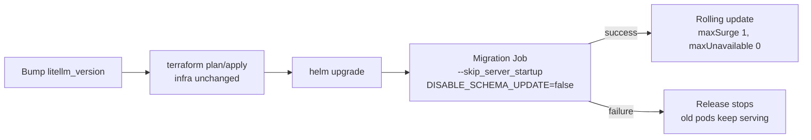

# Architecture

## Component map

| Layer | Resource | Why |
|---|---|---|
| Edge | EIP + dedicated ELB, elastic L7 flavor, two AZs | Public entry point, TLS termination, LCU-based billing |
| Compute | CCE cluster, 3 masters, one node pool per AZ | Survives an AZ loss and reschedules pods |
| Application | 3 LiteLLM replicas, 1 Uvicorn worker each | Stateless; scale with replicas |
| State | RDS PostgreSQL 16 primary/standby, two AZs | Keys, teams, budgets, spend logs, config |
| Coordination | DCS Redis 7 primary/standby, two AZs | Cross-replica rate limits, router state, cache |
| Egress | NAT gateway + SNAT | Private pods reaching model APIs |
| Secrets | CSMS + generated passwords | No static credentials anywhere |
| Keys | KMS | RDS volume and node disk encryption |
| Logs | LTS + ELB log association | Access logs without an agent |
| Alerts | Cloud Eye → SMN → email | Opt-in; metric names vary by region |

## Request path

1. Client calls `https://<eip>/v1/chat/completions` with a virtual key.
2. The ELB terminates TLS with the certificate referenced by the CCE Service
   annotation, and forwards to the Service's node port.
3. kube-proxy picks one of the three pods. Readiness (`/health/readiness`)
   keeps pods with a broken database connection out of rotation.
4. The pod authenticates the virtual key. Authentication and spend metadata come
   from PostgreSQL; rate-limit counters and the response cache come from Redis.
5. The router selects a model deployment (retries and fallbacks are configured
   in `config/litellm-config.yaml`).
6. The request leaves through the NAT gateway, or through the ModelArts VPC
   endpoint when private inference is enabled.

## Failure domains

| Failure | Impact | Recovery |
|---|---|---|
| One pod dies | None; two remain | Deployment recreates it; readiness gates traffic |
| One worker node dies | Pods on it reschedule | CCE reschedules; PDB keeps 2 available |
| One AZ fails | Loses one node and one ELB AZ | Remaining two AZs serve; RDS/DCS fail over |
| RDS primary fails | Writes pause during failover | Managed failover to the standby in the second AZ |
| RDS is unreachable | Readiness 503 → pods leave rotation | Fix connectivity; `allow_requests_on_db_unavailable` is deliberately **not** enabled |
| Redis primary fails | Brief cache/rate-limit errors | DCS failover; gateway keeps serving |
| NAT gateway fails | No egress to external models | Single NAT is a known limitation; recreate or add a second one |
| Bad release | Rolling update stops at `maxUnavailable: 0` | Roll back the image; migrations are not reversible |

## Why CCE and not plain VMs

The gateway is stateless, so Kubernetes buys three things that are expensive to
script on VMs: hitless rolling updates, readiness-gated traffic, and
rescheduling after a node failure. The VM example exists for evaluation and for
teams that cannot run a cluster, not as a production topology.

## Ownership boundaries

| Owned by Terraform | Owned by Helm |
|---|---|
| VPC, subnets, security groups | Deployment, Service, ConfigMap |
| CCE cluster and node pools | PodDisruptionBudget, HPA (optional) |
| RDS, DCS, KMS, CSMS | Migration Job (pre-install/pre-upgrade hook) |
| ELB, EIP, certificate reference | Probes, topology spread, resource limits |
| LTS, SMN, Cloud Eye alarms | — |

The split matters during an incident: changing the image is a Helm operation and
takes seconds; changing the database size is a Terraform operation and takes
tens of minutes.

## Upgrade flow

The gateway pods run with `DISABLE_SCHEMA_UPDATE=true`. They never race each
other applying Prisma migrations, and a failed migration cannot leave a
half-upgraded fleet.

## Known limitations

- **Single region.** Multi-region active/active is out of scope; the LiteLLM
  docs describe a shared-database multi-region topology if you need it.
- **Single NAT gateway.** Egress is an AZ-scoped dependency.
- **No autoscaling by default.** LiteLLM replicas take minutes to become
  useful, so HPA is opt-in and CPU-based only.
- **Cloud Eye alarms are opt-in.** Metric names and dimensions differ between
  regions; guessing them would produce a broken first apply.
- **CCE Service annotations are isolated in one script.** If your CCE version
  expects a different annotation set, only `scripts/deploy-app.sh` changes.
