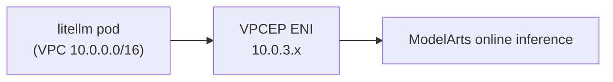

# Calling ModelArts over a private network

By default the gateway reaches model APIs through the NAT gateway, over the
public internet. For ModelArts online inference you can keep traffic inside the
VPC with a VPC endpoint (VPCEP), which is what Huawei Cloud calls
"内网接入" (intranet access).

This matters when inference must not traverse the public internet, or when
latency and egress cost are a concern.

## How it works



The endpoint gets a private IP in the dedicated VPCE subnet. The gateway calls
`http://<endpoint>/v1/...` exactly like any OpenAI-compatible provider, so
nothing in LiteLLM changes except `api_base`.

## Two ways to create it — pick one

### Option A: ModelArts console flow

The ModelArts console can create the endpoint for you:

1. Open **模型推理 → 在线推理**, find the service (status must be 运行中) and copy
   its service ID.
2. Open **内网接入管理 → 我的申请 → 创建**.
3. Choose the network type:
   - **用户网络**: select your VPC and subnet (use the VPCE subnet created by
     this repository, `10.0.3.0/28` by default).
   - **资源池网络**: select the resource pool.
4. Optionally add a custom access address. Up to 10 URLs per connection.
5. Submit and wait for the status to become **接入成功**; copy the access
   address shown in the list.

Caveats from the service documentation:

- one intranet connection per VPC per inference service;
- the request may need approval unless "免审批" was enabled on the service;
- deleting the connection deletes the endpoint.

### Option B: Terraform-managed endpoint

If you prefer the endpoint to be part of the stack:

```hcl
vpce_enabled              = true
modelarts_vpce_service_id = "<vpcep service id>"
```

This creates `huaweicloud_vpcep_endpoint` in the VPCE subnet and outputs the
private IP as `modelarts_endpoint`.

Do **not** run both options for the same service and VPC — the console flow
creates its own endpoint, and a second one conflicts.

## Permissions

The console flow needs, at minimum:

| Action | Purpose |
|---|---|
| `modelarts:workspace:get` | workspace access |
| `modelarts:service:list` | list inference services |
| `modelarts:pool:list` | list resource pools |
| `vpc:vpcs:list`, `vpc:subnets:get` | pick the VPC/subnet |
| `modelarts:intranetConnection:list/create/update/delete` | manage the connection |

ModelArts also needs a delegated agency that can create and delete VPCEP
endpoints (`vpcep:endpoints:create/delete/get/list`). Configure it once under
ModelArts → 授权.

## Wiring it into LiteLLM

Add the access address to `secrets/app.env`:

```bash
MODELARTS_API_BASE=http://10.0.3.42/v1
MODELARTS_API_KEY=<key issued by ModelArts/MaaS>
```

The sample model in `config/litellm-config.yaml` already reads both variables:

```yaml
- model_name: maas-chat
  litellm_params:
    model: openai/DeepSeek-V4-Flash
    api_base: os.environ/MODELARTS_API_BASE
    api_key: os.environ/MODELARTS_API_KEY
```

The `openai/` prefix tells LiteLLM to use the OpenAI-compatible path, so the
model name is passed through unchanged.

## Verify from inside the cluster

```bash
kubectl -n litellm exec deploy/litellm -- \
  curl -sS http://10.0.3.42/v1/models \
  -H "Authorization: Bearer $MODELARTS_API_KEY"
```

If that hangs, the endpoint IP is not reachable from the pod subnet — check the
VPCE subnet route and the endpoint status.

## Security groups and DNS

- The endpoint ENI sits in the VPCE subnet; the pod subnet must be able to route
  to it (it is inside the VPC, so this is automatic).
- If you enable private DNS (`enable_dns = true`), use the private domain name
  instead of the IP; it survives endpoint recreation.
- Do not open the endpoint to `0.0.0.0/0`; the VPCEP whitelist is the control
  plane for who may use it.
- Keep the NAT gateway if the gateway also calls public providers; the endpoint
  only covers ModelArts.

## When to use the public endpoint instead

MaaS often exposes a public HTTPS endpoint with normal API-key auth. That is
simpler and works without VPCEP, at the cost of public egress. Use the private
path when compliance, latency or egress cost demand it.
